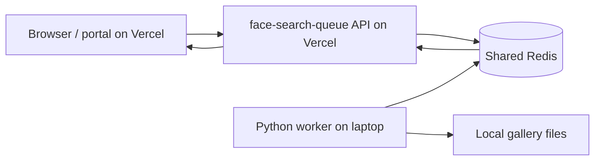

# Face Search Queue and Worker Setup

This guide explains how to run the face-search queue on Vercel and run its Python worker on a separate Windows laptop. It also covers the optional NVIDIA GPU setup, gallery file layout, Redis configuration, and troubleshooting.

## 1. How the parts work together

The laptop does not receive HTTP requests from Vercel. The portal submits each face-search job to the queue API. The queue stores the job in Redis. The Python worker connects outbound to that same Redis instance, consumes the job, searches its local gallery files, and writes its result back to Redis. The browser receives the result from the queue API.



The laptop therefore needs outbound internet access to Redis. It does not need a public IP, an HTTP server, a tunnel, or inbound port forwarding. Do not point the worker at `localhost`; that would mean Redis running on the laptop, separate from the queue's Redis.

## 2. What you need

- The portal deployed on Vercel.
- The `face-search-queue` directory deployed as a separate Vercel project.
- A Redis-compatible service with a **direct TCP endpoint** that both Vercel and the laptop can reach. A REST-only Redis endpoint is not compatible with these BullMQ clients.
- Redis 6.2 or newer. BullMQ's Python package requires Python 3.10 or newer and is interoperable with the Node BullMQ queue used by the queue API. See the [BullMQ Python documentation](https://docs.bullmq.io/python/introduction).
- The convocation gallery copied to the laptop, with the directory and file names preserved.
- On Windows, 64-bit Python 3.10 is the recommended starting point for the included DeepFace environment.

Use a dedicated, password-protected Redis instance for the face-search queue. Enable TLS if the provider supports it. BullMQ recommends the Redis `maxmemory-policy` be set to `noeviction`; see [BullMQ connection guidance](https://docs.bullmq.io/guide/connections).

## 3. Create or configure Redis

Create a Redis instance with a direct TCP endpoint. From the provider's connection details, record:

| Value | Example | Used as |
|---|---|---|
| Host | `my-redis.example.net` | `REDIS_HOST` |
| Port | `6380` | `REDIS_PORT` |
| Username | `default` | `REDIS_USERNAME` (if provided) |
| Password | Secret value | `REDIS_PASSWORD` |
| TLS | Enabled or disabled | `REDIS_TLS=true` or `false` |

Use the provider's **host only** for `REDIS_HOST`; do not include `redis://` or `rediss://`. Use the port from the same endpoint. If the provider gives a TLS endpoint, set `REDIS_TLS=true` and use its TLS port. If it gives a non-TLS endpoint, set `REDIS_TLS=false`.

Do not use a Redis REST URL. Do not expose a Redis server running on the laptop to the public internet. Both Vercel and the laptop should connect outward to the managed Redis endpoint.

## 4. Deploy the queue API on Vercel

The queue is a separate Next.js app at `face-search-queue/`; deploying only the portal project does not deploy this app automatically.

1. In the Vercel dashboard, create a project from the same Git repository.
2. Set **Root Directory** to `face-search-queue`.
3. Let Vercel detect Next.js and use the app's normal install/build settings.
4. In the queue project's **Settings → Environment Variables**, add the following values for **Production**. Add Preview too if you want preview deployments to use the same queue.

```text
REDIS_HOST=<host from your Redis provider>
REDIS_PORT=<port from your Redis provider>
REDIS_USERNAME=<username from your Redis provider, or default if required>
REDIS_PASSWORD=<password from your Redis provider>
REDIS_TLS=true
```

Set `REDIS_TLS=false` if the Redis endpoint is not TLS-enabled. Keep `REDIS_PASSWORD` server-side; never use a `VITE_` prefix for it.

5. Deploy the project and note its production origin, for example `https://face-search-queue.vercel.app`.
6. Open `https://<queue-origin>/api/health`. It should return JSON with `"status":"ok"` and, critically, `"redis":"up"`. The endpoint can return `status: ok` even when Redis is down, so check both fields.

The same Redis host, port, username, password, and TLS mode must be configured on the laptop worker.

### Point the portal to the queue deployment

The portal tries `https://face-search.<portal-host>/api` first, then falls back to `https://face-search-queue.vercel.app/api`. If the queue's production origin is not `https://face-search-queue.vercel.app`, add this **build-time** variable to the portal Vercel project:

```text
VITE_QUEUE_FALLBACK_URL=https://<queue-production-origin>
```

Use the origin only: do not add `/api` or a trailing slash. Redeploy the portal after adding or changing this variable because Vite embeds it into the frontend build. If the queue is available at the default fallback domain, this variable can be omitted.

## 5. Copy the gallery to the laptop

The worker searches files on its own disk. It does not download photos from Google Drive or Vercel. Copy the gallery folders to the laptop and preserve each folder name and photo filename exactly as they appear in Drive.

The configured gallery root should contain day folders, then time folders, then stage folders, then the images:

```text
C:/FaceSearch/Jain 15th Convocation/
└── 20-11-2025 Day 2/
    └── 09.30AM to 01PM/
        └── Station 1 (Right)/
            ├── photo-name.jpg
            ├── another-photo.jpeg
            └── ...
```

The exact folder names depend on the Drive tree. The portal sends the selected `day/time/stage` path with the job. The worker searches:

```text
CONVOCATION_PHOTOS_DIR/<day>/<time>/<stage>
```

The worker reads `.jpg`, `.jpeg`, and `.png` files. Its result IDs are relative paths, so the relative path and filename must match the path the portal uses for Drive images. Copy all stages that users should be able to search. Group Photos are excluded from face search in the portal.

## 6. Install the worker on Windows

Clone or copy the repository onto the laptop. Open PowerShell at the repository root and run:

```powershell
cd face-search-worker
py -3.10 -m venv .venv
.\.venv\Scripts\Activate.ps1
python -m pip install --upgrade pip
python -m pip install -r engines/deepface/requirements.txt
```

The requirements file now installs the DeepFace engine and its TensorFlow backend. The install is large and can take several minutes. The first face-search job can also download model files; let it finish while the laptop is online.

If PowerShell blocks virtual-environment activation, either allow local scripts for your Windows user with `Set-ExecutionPolicy -Scope CurrentUser RemoteSigned`, or skip activation and invoke the virtual environment's `python.exe` directly for the pip and worker commands.

### Configure the worker

From `face-search-worker`, copy the example environment file and edit it:

```powershell
Copy-Item .env.example .env
notepad .env
```

Set the values to the exact same Redis connection used by the Vercel queue project:

```env
REDIS_HOST=<same Redis host as the queue project>
REDIS_PORT=<same Redis port as the queue project>
REDIS_USERNAME=<same Redis username as the queue project>
REDIS_PASSWORD=<same Redis password as the queue project>
REDIS_TLS=true

CONVOCATION_PHOTOS_DIR=C:/FaceSearch/Jain 15th Convocation
USE_CPU=1
GPU_INDEX=0
WORKER_CONCURRENCY=1
```

Notes:

- Use `REDIS_TLS=true` for a TLS endpoint; otherwise use `false`.
- If your Redis provider has no username field, use the username it documents (often `default`) or leave it empty if the provider allows that.
- Set `CONVOCATION_PHOTOS_DIR` to the gallery root described in the previous section, not to one day or one stage folder. Forward slashes work in Windows paths.
- `USE_CPU=1` is the reliable first setup. Use `USE_CPU=0` only after confirming the GPU runtime works.
- Keep `WORKER_CONCURRENCY=1` initially. Increase it only after checking memory use and job stability.
- `.env` contains the Redis password. Keep it private and do not commit it. `.env.example` is the safe template to commit.

### Start the worker

From the `face-search-worker` directory, with `.venv` active:

```powershell
python worker.py --engine deepface
```

Keep this process running. A successful start logs that Redis connected, prints a worker ID, and says it is waiting for jobs. The queue dashboard should show the worker online. Stop it gracefully with `Ctrl+C`.

The worker laptop must stay awake and connected to the internet while it processes jobs. If Windows sleeps or the worker process stops, jobs remain in the queue until a worker reconnects.

## 7. Optional NVIDIA GPU setup

First confirm that the CPU worker connects to Redis and processes a job. Then configure GPU support if the laptop has a supported NVIDIA GPU.

For current TensorFlow GPU support, use Linux or Windows with WSL2. TensorFlow's current guide says native Windows GPU support stops after TensorFlow 2.10; see the [TensorFlow pip installation guide](https://www.tensorflow.org/install/pip).

In Linux or WSL2:

1. Install a current NVIDIA driver with WSL support on Windows if applicable.
2. Verify `nvidia-smi` works in the Linux environment.
3. Create the Python environment and install the worker requirements as above.
4. Install the TensorFlow CUDA extra in that environment:

   ```bash
   python -m pip install 'tensorflow[and-cuda]'
   ```

5. Verify TensorFlow sees the GPU:

   ```bash
   python -c "import tensorflow as tf; print(tf.config.list_physical_devices('GPU'))"
   ```

6. Set `USE_CPU=0` in the worker `.env` file and start the worker again. Keep `GPU_INDEX=0` for the first GPU.

TensorFlow GPU requirements change over time, so follow the linked TensorFlow guide if the current driver, CUDA, or Python versions differ.

## 8. First end-to-end search

1. Confirm the queue health endpoint reports `"redis":"up"`.
2. Start the worker and confirm its Redis connection and waiting status in the terminal.
3. Confirm the worker appears online in the queue dashboard.
4. Sign into the deployed portal and open a gallery stage that is present on the laptop.
5. Submit a face search.
6. Watch the worker log. It should show the job ID, selected stage, and a nonzero number of gallery images.
7. Wait for the job to finish; the results should appear in the portal.

## 9. Troubleshooting

| Symptom | Check |
|---|---|
| Queue health says `redis: down` | Check the queue Vercel project's Redis host, port, password, username, TLS mode, and redeploy after environment changes. |
| Worker reports connection refused or timeout | Confirm the laptop can reach the provider's direct TCP endpoint, use its correct port, and check provider network access rules. Do not use `localhost`. |
| Worker reports authentication/TLS errors | Make the worker's Redis values exactly match the queue project's values. Use the TLS port with `REDIS_TLS=true`. |
| Queue dashboard shows no worker | Confirm the worker says Redis connected and uses the same Redis instance as the queue. The queue name must remain `face-search`. |
| Job stays waiting | The worker may be stopped, disconnected, or connected to a different Redis database/instance. Check the worker terminal and queue dashboard. |
| Worker says gallery folder does not exist or processes zero images | Check `CONVOCATION_PHOTOS_DIR`, then verify exact day/time/stage names and that the files are `.jpg`, `.jpeg`, or `.png`. |
| Search completes but no useful matches | Check that the laptop copy contains the same gallery files as Drive, and use a clear selfie with one visible face. |
| First job is slow | DeepFace may be downloading its model files and the worker must inspect every image in the selected stage. Let the first job complete; subsequent runs can reuse local model files and in-memory encodings. |

## 10. Security and data handling

- Use a dedicated Redis instance, a strong password, and TLS where supported. Do not expose Redis publicly without authentication.
- Do not open an inbound port on the worker laptop. The worker makes outbound Redis connections.
- A job payload includes the selfie image and user ID. The queue configuration retains completed jobs for 24 hours and failed jobs for 7 days; account for that when choosing and configuring Redis.
- Never put `REDIS_PASSWORD` in frontend code or a `VITE_*` environment variable.

## References

- [BullMQ Python introduction and compatibility](https://docs.bullmq.io/python/introduction)
- [BullMQ Redis connection requirements](https://docs.bullmq.io/guide/connections)
- [TensorFlow installation and platform requirements](https://www.tensorflow.org/install/pip)
